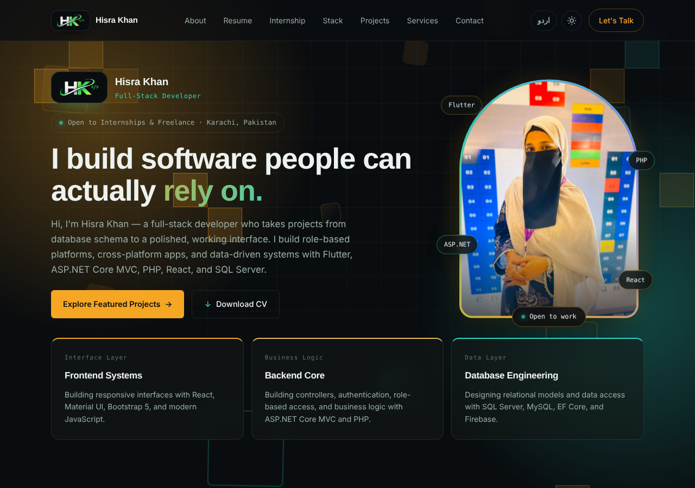
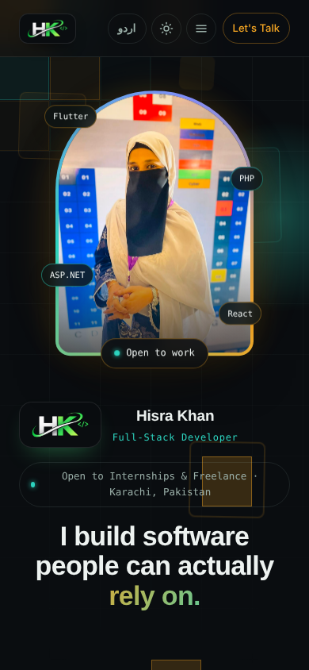

# 🎨 Hisra Khan | Personal Portfolio

A responsive personal portfolio website that presents my skills, projects, internship experience and contact details, like a digital résumé. It has a dark/light theme and works in English and Urdu.

> **Oasis Infobyte Internship**: Web Development & Designing, Level 1, Task 2

## ✨ Features

### Required checklist
- **Hero section** with my name, role title (Full-Stack Developer), a short introduction, my photo and call-to-action buttons
- **About Me** section with my background and interests
- **Skills & Technologies** as a visual grid of 9 cards (45 skills), each skill with its own logo or icon
- **Projects** section with 13 project cards, each with a screenshot, description, tech tags and a GitHub link, plus filter buttons (All, Full-Stack, Frontend, Mobile, AI & Automation); the Frontend filter includes the three Oasis Infobyte tasks
- **Contact** section with my name, email, phone, LinkedIn and GitHub as icon cards, plus a CV download
- **Smooth scroll navigation** between sections with an active-link highlight and a scroll progress bar
- **Consistent branding:** one colour palette (amber and teal), the same fonts and the same card style throughout
- **Fully responsive:** tested from 1280px down to 320px, with a mobile menu on tablets and phones

### Extra touches
- **Resume** and **Internship** sections for my two internships, each with its three tasks: **NEXLEVR** (Agentic AI Developer Intern, Dec 1 – Dec 31, 2026, remote) and **Oasis Infobyte** (Web Development & Designing Intern, Nov 2026, 1 month, Level 1)
- **Services** section and a project enquiry form that opens the visitor's email app with the brief filled in
- Dark / light theme switch (remembered in the browser)
- English / Urdu switch with right-to-left layout (`i18n.js`)
- Reveal animations, hover effects and a soft cursor glow on desktop; `prefers-reduced-motion` is respected
- Accessible markup: semantic HTML, alt text on images, labelled buttons, keyboard-friendly menu (Escape closes it)

## 🧱 Tech stack

HTML5, CSS3 (Flexbox, Grid, CSS variables, media queries) and vanilla JavaScript. No frameworks.

## 📂 Projects shown

CurrenSee, Testing System, Thunder Peak Adventure Park, Stylist Store, Food Saver, Career Guidance Platform, Crime Portal, Daily Trends Digest Agent, First Tool-Using AI, Workflows vs Agents Design Doc, NovaFit Landing Page, Personal Portfolio and ThermoLab Temperature Converter.

## 📁 Project structure

```
WebDev-L1-PersonalPortfolio/
├── index.html
├── style.css
├── script.js        # interactions: menu, theme, filters, animations
├── i18n.js          # English / Urdu translations
├── hisrak.jpeg      # profile photo
├── Hisra_Khan_CV.pdf
├── images/          # project screenshots
├── icons/           # skill logos and icons
├── screenshots/     # desktop.png and mobile.png for this README
└── README.md
```

## ▶️ How to run

1. Download or clone this repository.
2. Open `index.html` in any modern browser (or use the VS Code **Live Server** extension).

The Google Fonts need an internet connection; system fonts are used as a fallback when offline.

## 🌐 Live demos

- NovaFit Landing Page: https://oibsip-landing-page-phi.vercel.app/
- ThermoLab Temperature Converter: https://oibsiptemperatureconverter.vercel.app/

## 📸 Screenshots

| Desktop | Mobile |
|---|---|
|  |  |

## 👤 Author

**Hisra Khan** | Oasis Infobyte Web Development Intern
